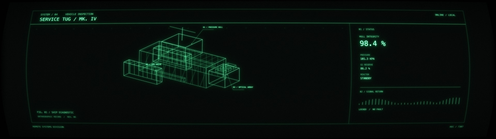
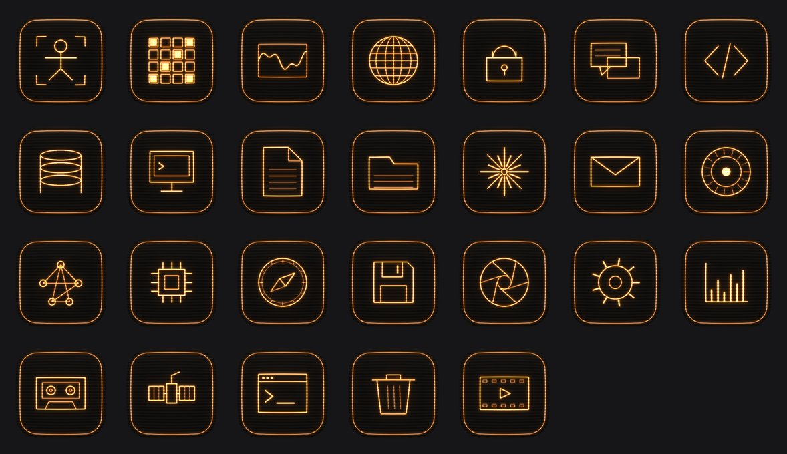

# Cassette futurism

Procedural wallpaper and macOS icon generator in the cassette futurism / terminal-UI style. Line art is drawn as vectors, bloomed like a phosphor tube, then run through a CRT stage: barrel distortion, chromatic aberration, curved scanlines, aperture mask.
Every image is seeded, so any output is reproducible from the number in its filename.

<p align="center">
  
</p>
<p align="center">
  
</p>

## Why

Couldn't find any wallpaper I liked for ultrawide res in this style, it was never quite the HUD feel I wanted, if I were to find it then I couldn't get a matching one for the laptop screen. Also was a fun challenge to learn bit more about python, quality could be better but for now it runs

## Quick start

If you'd rather not touch the command line beyond one paste, open Terminal and run:

```bash
git clone https://github.com/Gallyfreian/cassette-futurism.git && open cassette-futurism
```

A Finder window opens. Double-click **`run.command`** and follow the prompts.

### What `run.command` actually does

It uses a small [setup shell script](run.command), then starts the
[Python terminal console](launcher.py). Both are readable source.

On **first run** it will:

1. Check that Python 3 is installed. If it isn't, it tells you and stops.
2. Ask permission before doing anything else.
3. Create a folder called `.venv` inside the project directory. This is a
   self-contained Python environment, roughly 50 MB.
4. Install two libraries into that folder: Pillow (image handling) and numpy (maths).

**Nothing is installed system-wide, and nothing is written outside this folder.**
To undo it completely, delete the `.venv` folder, or delete the whole project
directory. There's no uninstaller because there's nothing to uninstall.

On **every run** it opens a phosphor-styled control console: dark background,
framed panels, mission descriptions, a render manifest and file-count progress.
Choose **Theme** to switch the interface between green, amber, ice, blood and
bone; this is independent of the palette used for generated images. The console
uses the Python standard library and does not modify your Terminal profile or
shell configuration.

[Preview the console](docs/preview-console.png).

The menu offers:

- **Wallpapers** — asks for resolution (or a custom one), how many, palette,
  CRT bulge, clutter density and an optional reproducible seed
- **Icons** — asks for palette, CRT bulge, whether to build `.icns` files
- **Both**
- **Quit**
- **Theme** — change the console color for this session

Answers accept either the option number or the name. Pressing return or enter
without inputing anything takes the default shown in brackets.
Output goes to `wallpapers/` or `icons/`, and the
folder opens when it's finished.

Review the settings in the render manifest, then press Enter to render.
Output files with matching names are replaced, as with the generator CLIs.

Run `./run.command --theme amber` to start in amber, or `./run.command --plain`
for a plain-text interface. `NO_COLOR`, redirected input/output and terminals
without ANSI support automatically use plain text. The styled console restores
the previous screen and resets its colors when it exits. Window size is checked
on each screen; narrow windows wrap the content.

Type `b` then `enter` at any prompt to return to the main menu. Ctrl-C during a render
stops it and returns to the menu too.

### If macOS blocks the script

macOS attaches a **quarantine flag** to files that arrive through a web browser,
and refuses to run them until you approve it in System Settings. This is
Gatekeeper doing its job, it can't tell a wallpaper generator from anything
else.

**Cloning the repo avoids this entirely.** `git clone` doesn't set the quarantine
flag, so if you used the Quick start command above you'll never see it.

If you used the green **Code -> Download ZIP** button instead, you'll hit the
prompt on every launch. Clear it once, from inside the project folder:

```bash
xattr -cr .
```

Then double-click as normal. The prompt won't come back.

The only way to make a _downloaded_ file double-click cleanly is to sign and
notarize it with Apple, which needs a paid developer account (as far as I am aware).

## Install (manual)

Requires Python 3.9+.

```bash
git clone https://github.com/Gallyfreian/cassette-futurism.git
cd cassette-futurism
python3 -m venv .venv && source .venv/bin/activate
pip install -r requirements.txt
```

On macOS, the venv is not optional — `pip install` against Homebrew's Python
without one fails with `externally-managed-environment`.

Remember to `source .venv/bin/activate` in each new terminal session.

## Wallpapers

```bash
python3 wallgen.py --size 5120x1440 --count 20
python3 wallgen.py --size 3456x2234 --seed 7048 --palette amber
python3 wallgen.py --size 3840x2160 --crt 0.22 --busy 0.9 --palette blood
```

| flag         | default        | what it does                                                        |
| ------------ | -------------- | ------------------------------------------------------------------- |
| `--scene`    | `auto`         | terminal subject; choose one of the nine below, or `legacy`          |
| `--size`     | `5120x1440`    | `WIDTHxHEIGHT`. Layout switches to the wide composition above 2.0:1 |
| `--count`    | `1`            | number of images; each gets a consecutive seed                      |
| `--seed`     | random         | reproduces a specific image                                         |
| `--palette`  | random         | `amber`, `green`, `ice`, `blood`, `bone`                            |
| `--crt`      | `0.14`         | barrel strength. `0.06` subtle, `0.24` heavy                        |
| `--flat`     | off            | disable the CRT stage entirely                                      |
| `--busy`     | `0.55`         | instrument clutter, `0.2` sparse to `1.0` dense                     |
| `--scan`     | `0.34`         | scanline depth, `0` off to `0.6` heavy                              |
| `--scan-px`  | `4.0`          | scanline period in output pixels. `4` at 4K, `2.5` at 1080p         |
| `--wordmark` | random         | fixed text, or `none` to omit                                       |
| `--out`      | `./wallpapers` | output directory                                                    |

The default now chooses between nine composed terminal subjects. Each has a
substantial central drawing, fixed panel hierarchy, related telemetry, and quiet
margins for the menu bar and Dock:

- `--scene ship`: axonometric service tug with pressure hull, engine pods and annotations.
- `--scene archive`: reel transport with tape path, heads and mechanical controls.
- `--scene survey`: connected terrain mesh and survey readouts.
- `--scene tracking`: wireframe Earth, inclined orbit, ground stations and ground track.
- `--scene launch`: staged launch vehicle with altitude and velocity histories.
- `--scene probe`: deep-space spacecraft with steerable dish, arrays and instrument boom.
- `--scene docking`: station approach corridor, alignment crosshair and position plot.
- `--scene comms`: tracking antenna with pointing geometry and receiver spectrum.
- `--scene descent`: lunar terrain profile, lander, landing target and predicted descent.
- `--scene auto`: seeded choice of all nine (default).
- `--scene legacy`: the original six abstract heroes and scattered widgets.

```bash
python3 wallgen.py --size 5120x1440 --scene ship --seed 7048 --palette green
python3 wallgen.py --size 3456x2234 --scene archive --seed 7048 --palette amber
python3 wallgen.py --size 5120x1440 --scene tracking --seed 91 --palette green
python3 wallgen.py --size 3456x2234 --scene probe --seed 7048 --palette amber
```

The six mission scenes use fictional, illustrative engineering data. Each seed
changes geometry and mission state together: orbit altitude sets the plotted
radius, docking offsets set the crosshair and alignment status, and radar
altitude sets the lander's height above its terrain. Vehicle configuration,
antenna pointing, array count, flight phase and signal acquisition also vary.
These are coherent terminal illustrations, not flight simulations or historical
NASA screen reproductions.

See the [labeled mission collection](docs/preview-missions.jpg) for all six scenes
in green and amber with different seeds. Full-size review renders are generated
locally under `out/missions/`.

Expanding the `auto` pool changes which scene an earlier automatic seed selects.
Use an explicit `--scene` to reproduce a particular subject. The existing three
explicit scenes retain their rendering behavior.

`--busy` controls optional terminal detail in the new scenes and widget density
in legacy mode. Seeds reproduce output for the same generator version, scene,
and render options. Existing legacy seeds can be rendered with `--scene legacy`.

Preview the [tape archive](docs/preview-wallpaper-archive.jpg) and
[terrain survey](docs/preview-wallpaper-survey.jpg).

## Icons

`icongen.py` imports from `wallgen.py`, so keep them in the same directory.

```bash
python3 icongen.py --list
python3 icongen.py --palette green
python3 icongen.py --icns --map "Chrome=globe,dev-work=code,Certs=lock"
```

| flag           | default      | what it does                                                        |
| -------------- | ------------ | ------------------------------------------------------------------- |
| `--out`        | `./icons`    | output directory                                                    |
| `--size`       | `1024`       | square PNG size                                                     |
| `--palette`    | `amber`      | same five palettes                                                  |
| `--map`        | full library | `"Filename=glyph,Filename=glyph"` pairs                             |
| `--label`      | off          | print the name across the bottom of each icon                       |
| `--crt`        | `0.12`       | tube bulge. Past `0.22` the tile stops matching the macOS icon grid |
| `--scan`       | `0.30`       | scanline depth                                                      |
| `--scan-lines` | `34`         | lines across the tile, counted so they survive Dock downscaling     |
| `--icns`       | off          | also build a multi-resolution `.icns` (macOS only)                  |

26 glyphs: `folder`, `terminal`, `globe`, `code`, `compass`, `starburst`, `disc`,
`chat`, `person`, `document`, `aperture`, `film`, `bin`, `gear`, `waveform`,
`database`, `chart`, `lock`, `network`, `mail`, `grid`, `cassette`, `chip`,
`floppy`, `monitor`, `satellite`.

Output is 1024×1024 RGBA with the squircle as the alpha channel, so it sits on the
Dock without a black box.

With `--icns`, each rendition (16px up to 1024px) is drawn fresh at its target
size rather than downscaled, with scanlines and bulge reduced on the small ones so
they stay legible in the sidebar and Finder list view.

If Apple’s `iconutil` is unavailable or rejects the iconset, export falls back
to Pillow using the freshly drawn 32–1024px renditions. That fallback omits the
separate 16px rendition.

### Clear icon appearance (experimental)

[Monochrome icon preview](docs/preview-icons-mono.jpg).

The phosphor style bakes a dark tile, bloom, thin strokes and scanlines into a
flat image. It is designed for the default Dock appearance. macOS Clear styling
can reinterpret that artwork and lose its contrast. Apple supports explicit
mono/clear variants through layered Icon Composer assets; a custom Finder
PNG/ICNS replacement does not provide those appearance variants.

Try the simpler foreground export in a separate folder:

```bash
python3 icongen.py --style mono --icns --out icons/mono
```

`mono` draws thicker white strokes on transparency, without a tile, border,
bloom, scanlines, barrel distortion or labels. Palette and CRT options apply
only to `phosphor`. This export is an experiment for checking on your own Dock,
not a native Liquid Glass icon or a promise of Clear compatibility. Both
styles are ordinary replacement icons; no application bundles or system
appearance settings are modified by the generator.

See [Apple's Icon Composer documentation](https://developer.apple.com/documentation/xcode/creating-your-app-icon-using-icon-composer)
for native default, dark and mono appearances.

### Applying icons on macOS

1. Open the `.png` (or `.icns`) in Preview, then <kbd>⌘A</kbd> and <kbd>⌘C</kbd> to copy it.
2. Select the app or folder in Finder and press <kbd>⌘I</kbd> for Get Info.
3. Click the small icon in the **top-left corner** of the Info window so it highlights.
4. Press <kbd>⌘V</kbd>.

For batches, `brew install fileicon` then:

```bash
fileicon set /Applications/Ghostty.app ./icons/Ghostty.png
```

Custom icons are stored as an extended attribute on the file, not inside the app
bundle — so an app update wipes them. Keep the `icons/` folder around to re-apply.
This is true of `.icns` too; the format makes no difference.

## Notes and limitations

- **Barrel distortion is aspect-aware.** The naive shader approach normalises each
  axis to `[-1,1]` and takes `r² = u²+v²`, which produces a fisheye rather than a
  tube on a 3.55:1 canvas. Horizontal curvature is scaled by
  `ax = clamp((16/9)/aspect, 0.30, 1.0)` — 0.5 at 32:9.
- **Scanlines vanish below ~64px.** Resolution floor, nothing to be done. Use
  `--scan 0` and a stronger `--crt` if most of your usage is small sidebar icons.
- **The aperture mask** darkens two of every three subpixel columns by 9%. Invisible
  at 4K, but reads as a colour cast if you downscale the output. Set `mask=0` in
  `crt()` if that bites.
- **Font fallback** walks Menlo → Courier New → DejaVu Sans Mono → Liberation Mono →
  Consolas. If none resolve, add a path to `_FONTS` in `wallgen.py`.
- The corner radius is 22.37% of the tile, Apple's squircle ratio, but approximated
  with a rounded rectangle rather than a true superellipse.
- `run.command` is macOS-only. PNG and ICNS generation also work on Linux and
  Windows; ICNS export uses Pillow when Apple’s `iconutil` is unavailable.

## Licence

MIT — see [LICENSE](LICENSE).


## Development checks

```bash
python3 -m unittest discover -s tests
bash -n run.command
```
